<div align="center">



# 🚀 Awesome SLAM & Navigation Platforms 🤖

**A curated index of production-ready SaaS platforms, enterprise SDKs, and state-of-the-art open-source software for Simultaneous Localization and Mapping (SLAM), Autonomous Mobile Robots (AMRs), and Sensor Fusion.**

<p align="center">
  <a href="https://github.com/ishandutta2007/Awesome-Awesome-Awesome"></a><a href="https://discord.gg/jc4xtF58Ve"></a>
  <a href="https://github.com/ishandutta2007/Awesome-SLAM-Navigation-Platforms/stargazers"></a>
  <a href="https://github.com/ishandutta2007/Awesome-SLAM-Navigation-Platforms/network/members"></a>
  <a href="https://github.com/ishandutta2007/Awesome-SLAM-Navigation-Platforms/blob/main/LICENSE"></a>
  <a href="https://github.com/ishandutta2007/Awesome-SLAM-Navigation-Platforms/pulls"></a>
  <a href="https://github.com/ishandutta2007"></a>
</p>

</div>

---

## 📖 Table of Contents
- [🔍 Overview](#-overview)
- [🌐 Sector Overview & Market Dynamics](#-sector-overview--market-dynamics)
- [🏢 SaaS & Commercial SLAM Navigation Platforms](#-saas--commercial-slam-navigation-platforms)
- [💻 Open-Source SLAM & Navigation Frameworks](#-open-source-slam--navigation-frameworks)
- [📊 Architectural Comparison: SLAM Paradigms](#-architectural-comparison-slam-paradigms)
- [🤝 How to Contribute](#-how-to-contribute)
- [☕ Support & Community](#-support--community)
- [⭐ Star History](#-star-history)
- [📜 Disclaimer](#-disclaimer)

---

## 🔍 Overview

**Simultaneous Localization and Mapping (SLAM)** is the foundational technology that enables autonomous mobile robots (AMRs), self-driving vehicles, uncrewed aerial vehicles (UAVs), and spatial computing devices to build geometric or semantic representations of unknown environments while tracking their exact 6-DoF pose within those maps.

Modern SLAM systems leverage tightly coupled sensor fusion across:
- **📷 Visual SLAM (vSLAM / VIO):** Monocular, stereo, and RGB-D cameras combined with Inertial Measurement Units (IMUs).
- **📡 LiDAR SLAM (LO / LIO):** 2D and 3D LiDAR point clouds matched via Iterative Closest Point (ICP), Normal Distributions Transform (NDT), or direct continuous-time optimization.
- **🛰️ Satellite-Inertial Fusion (GNSS/INS):** RTK-GPS coupled with wheel odometry and tactical IMUs for outdoor positioning.
- **⚡ Factor Graph Optimization:** Non-linear back-ends (e.g., GTSAM, Ceres) to eliminate drift through global loop closure.

---

## 🌐 Sector Overview & Market Dynamics

The global **Simultaneous Localization and Mapping (SLAM)** and autonomous navigation market is projected to reach between **$1.22 Billion and $3.97 Billion in 2026**, growing at a rapid Compound Annual Growth Rate (**CAGR of 26.8% to 37.0%**) from ~$890 Million to $3.10 Billion in 2025. This surge is propelled by accelerating warehouse automation, commercial drone fleets, self-driving delivery systems, and spatial computing headsets.

**Market Concentration & Dynamics:**  
The sector is **moderately fragmented**. While cloud hyperscalers (Google, Microsoft, AWS) and electric/autonomous automotive leaders invest in proprietary internal navigation pipelines, commercial B2B robotics remains distributed across specialized spatial AI vendors, sensor-agnostic SDK creators, AMR fleet management platforms, and 3D mapping hardware builders. The ecosystem avoids a winner-take-all monopoly due to wide variations in operational environments (GPS-denied tunnels, featureless industrial floors, dynamic agricultural terrain) and diverse compute/sensor constraints.

---

## 🏢 SaaS & Commercial SLAM Navigation Platforms

The following table summarizes enterprise SaaS products, cloud fleet management tools, and commercial SLAM engines, **sorted descending by company valuation / market scale**.

| Platform / Vendor | Company Valuation / Scale | Starting Pricing | Free Tier / Trial Limit | Key Capabilities & Deployment Target |
| :--- | :--- | :--- | :--- | :--- |
| **[Google ARCore Geospatial API](https://developers.google.com/ar)** | **~$2.1 Trillion** (Alphabet Inc. MCap) | **$0.00 / mo** (Pay-as-you-go GCP billing beyond free quota) | **Free forever quota**: 24,000 Geospatial requests/day + unlimited local Cloud Anchors within standard GCP rate limits | Visual SLAM & Visual Positioning Service (VPS) utilizing Google Street View 3D point clouds for global indoor/outdoor localization. |
| **[Skydio Cloud Autonomy](https://www.skydio.com/)** | **~$2.2 Billion** ($570M+ funding) | **$2,900 / year** per drone (Cloud Autonomy Fleet Manager) | **30-day enterprise evaluation**: Single drone live cloud telemetry, 3D scan mission planner, and fleet sync | 360° computer-vision autonomous flight navigation, obstacle avoidance, GPS-denied inspection, and automated 3D digital-twin mapping. |
| **[Kudan Inc.](https://www.kudan.io/)** (TYO: 4425) | **~$110 Million** (TYO MCap: ¥16.5B; ~$8M revenue) | **~$1,000 / year** (AR/SLAM Business License for teams <$1M revenue) | **Free forever development tier**: Unrestricted SDK feature testing & integration (displays watermark on published binaries) | Hardware-agnostic proprietary Visual SLAM (KdVisual) and 3D LiDAR SLAM (KdLidar); integrates multi-camera, LiDAR, and GNSS for industrial AMRs. |
| **[Formant.io](https://formant.io/)** | **~$90 Million** ($30M+ funding) | **$250 / device / month** (Base fleet operations tier) | **14-day full free trial**: Up to 3 active robot agents, live SLAM map telemetry streaming, and teleoperation control | Cloud robotics operations platform; ingests real-time ROS/ROS2 SLAM maps, point clouds, waypoints, and fleet teleoperation. |
| **[Foxglove](https://foxglove.dev/)** | **~$60 Million** ($15M Series A) | **$20 / user / month** (Pro Tier billed annually) | **Free forever plan**: 10 GB storage, 100 GB indexing/mo, 1 hr query time/mo, and up to 5 registered robots/devices | Integrated robotics visualization & observability suite; native support for ROS 1/2 bags, MCAP files, URDF models, and live 3D SLAM maps. |
| **[SLAMcore](https://www.slamcore.com/)** | **~$60 Million** ($40M funding) | **~$1,200 / year** (Commercial Developer SDK seat) | **30-day evaluation license**: Full spatial AI SDK access on Intel RealSense, Luxonis OAK-D, and NVIDIA Jetson hardware | High-speed visual-inertial SLAM for edge compute; real-time dense 2.5D/3D occupancy mapping with embedded person/obstacle semantic segmentation. |
| **[Cogniteam Nimbus](https://usenimbus.com/)** | **~$30 Million** ($5.6M funding) | **$25 / user / month** (Nimbus Cloud Lite) | **14-day free trial**: Full access to cloud simulation, containerized ROS/ROS 2 SLAM deployments (no credit card required) | Cloud robotics operating system; drag-and-drop autonomous navigation stacks, field deployment, fleet health monitoring, and remote diagnostics. |
| **[Polycam 3D](https://poly.cam/)** | **~$25 Million** ($18M funding) | **$12.50 / month** (Billed annually at $150/year) | **Free forever tier**: Unlimited basic LiDAR scans and Gaussian Splatting captures; exports restricted to GLTF and public sharing | Mobile LiDAR & photogrammetry SLAM capture engine; converts camera and sensor scans into textured 3D meshes, CAD drawings, and point clouds. |
| **[Kaarta Engine](https://www.kaarta.com/)** | **~$25 Million** (~$7M annual revenue) | **$30,000** (Turnkey Stencil/Contour hardware kit with perpetual engine license) | **Perpetual onboard license**: Lifetime onboard real-time processing and firmware algorithm upgrades with no monthly recurring fees | Real-time handheld and mobile 3D LiDAR mapping engine; builds centimeter-accurate registered point clouds on-the-fly without external GPS. |
| **[Inertial Sense LUNA](https://inertialsense.com/)** | **~$18 Million** ($10M+ funding) | **$480** (IMX-6 tactical sensor module + complimentary SDK/EvalTool) | **Free forever SDK access**: Complimentary EvalTool software, ROS/ROS 2 wrappers, and 30-day LUNA software PoC evaluation | Autonomy-as-a-service navigation platform; pairs dual-GNSS, RTK, and MEMS tactical IMUs with autonomous path planning and drive control. |
| **[Movel AI Seirios](https://movel.ai/)** | **~$15 Million** ($2.5M seed) | **$2,500 / robot / year** (Seirios RNS navigation module) | **15-day free trial**: Complete Seirios RNS software evaluation; 30-day pilot trial for multi-robot Fleet Management (FMS) | Modular robotics navigation stack (RNS) and fleet manager (FMS); delivers multi-sensor localization, dynamic path planning, and mixed-fleet traffic control. |

---

## 💻 Open-Source SLAM & Navigation Frameworks

A ranked index of leading open-source SLAM, visual-inertial odometry, LiDAR odometry, and robotics navigation repositories, **sorted descending by GitHub star count**.

| Repository & Stars | License | Primary Sensor Modal | Core Description |
| :--- | :--- | :--- | :--- |
| **[ORB-SLAM2](https://github.com/raulmur/ORB_SLAM2)** [](https://github.com/raulmur/ORB_SLAM2/stargazers) | GPL-3.0 | Monocular / Stereo / RGB-D | Foundational real-time visual SLAM library featuring bundle adjustment, loop closing, and place recognition via DBoW2. |
| **[ORB-SLAM3](https://github.com/UZ-SLAMLab/ORB_SLAM3)** [](https://github.com/UZ-SLAMLab/ORB_SLAM3/stargazers) | GPL-3.0 | Visual-Inertial (Mono/Stereo/RGB-D + IMU) | State-of-the-art multi-map visual and visual-inertial SLAM library with Atlas multi-session capabilities and IMU initialization. |
| **[Cartographer](https://github.com/cartographer-project/cartographer)** [](https://github.com/cartographer-project/cartographer/stargazers) | Apache-2.0 | 2D / 3D LiDAR + IMU | Google's industrial-grade real-time SLAM system providing submap generation and sparse loop-closure optimization. |
| **[VINS-Mono](https://github.com/HKUST-Aerial-Robotics/VINS-Mono)** [](https://github.com/HKUST-Aerial-Robotics/VINS-Mono/stargazers) | GPL-3.0 | Monocular Camera + IMU | Optimization-based monocular visual-inertial state estimator developed by HKUST, including loop detection and relocalization. |
| **[FAST_LIO](https://github.com/hku-mars/FAST_LIO)** [](https://github.com/hku-mars/FAST_LIO/stargazers) | GPL-3.0 | LiDAR + IMU | Computationally lightweight and ultra-fast LiDAR-inertial odometry package built on iterated extended Kalman filtering (ikf-om). |
| **[LIO-SAM](https://github.com/TixiaoShan/LIO-SAM)** [](https://github.com/TixiaoShan/LIO-SAM/stargazers) | BSD-3-Clause | 3D LiDAR + 9-Axis IMU + GPS | Tightly coupled LiDAR-inertial odometry framework formulated on factor graph smoothing and mapping (iSAM2). |
| **[Nav2 (ROS 2)](https://github.com/ros-navigation/navigation2)** [](https://github.com/ros-navigation/navigation2/stargazers) | Apache-2.0 | Any Kinematic Mobile Base | The industry-standard navigation stack for ROS 2, orchestrating planners, controllers, recovery behaviors, and Behavior Trees. |
| **[VINS-Fusion](https://github.com/HKUST-Aerial-Robotics/VINS-Fusion)** [](https://github.com/HKUST-Aerial-Robotics/VINS-Fusion/stargazers) | GPL-3.0 | Stereo / Mono + IMU + GPS | Multi-sensor extension of VINS supporting stereo visual-inertial odometry and global pose graph optimization with GPS fusion. |
| **[FAST-LIVO2](https://github.com/hku-mars/FAST-LIVO2)** [](https://github.com/hku-mars/FAST-LIVO2/stargazers) | GPL-3.0 | LiDAR + Visual Camera + IMU | Fast direct LiDAR-inertial-visual odometry providing real-time dense photometric and geometric point cloud reconstruction. |
| **[evo](https://github.com/MichaelGrupp/evo)** [](https://github.com/MichaelGrupp/evo/stargazers) | BSD-3-Clause | Trajectory Evaluation Suite | Python package for benchmarking, handling, and evaluating odometry and SLAM trajectories (APE, RPE, alignment tools). |
| **[RTAB-Map](https://github.com/introlab/rtabmap)** [](https://github.com/introlab/rtabmap/stargazers) | BSD-3-Clause | RGB-D / Stereo / 2D/3D LiDAR | Real-Time Appearance-Based Mapping library with memory management for long-term large-scale online 6-DoF SLAM. |
| **[GTSAM](https://github.com/borglab/gtsam)** [](https://github.com/borglab/gtsam/stargazers) | BSD-3-Clause | Optimization Engine | Factor graph library implementing Smoothing and Mapping (SAM) in robotics and computer vision using Bayes Tree algorithms. |
| **[OpenVINS](https://github.com/rpng/open_vins)** [](https://github.com/rpng/open_vins/stargazers) | GPL-3.0 | Visual-Inertial (Filter-Based) | High-performance, research-grade platform for visual-inertial navigation with multi-camera and IMU online calibration. |
| **[OpenVSLAM](https://github.com/xdspacelab/openvslam)** [](https://github.com/xdspacelab/openvslam/stargazers) | BSD-2-Clause | Perspective / Fisheye / Equirectangular | Versatile visual SLAM engine supporting equirectangular panoramic cameras, map storage, and localization modes. |
| **[LeGO-LOAM](https://github.com/RobustFieldAutonomyLab/LeGO-LOAM)** [](https://github.com/RobustFieldAutonomyLab/LeGO-LOAM/stargazers) | BSD-3-Clause | 3D LiDAR (Ground-Optimized) | Lightweight LiDAR odometry and mapping algorithm optimized for ground vehicles on rough terrain with ground extraction. |
| **[DROID-SLAM](https://github.com/princeton-vl/DROID-SLAM)** [](https://github.com/princeton-vl/DROID-SLAM/stargazers) | MIT | Deep Learning Visual SLAM | Deep Visual SLAM system utilizing recurrent memory networks with differentiable Dense Bundle Adjustment (DBA) for robustness. |
| **[slam_toolbox](https://github.com/SteveMacenski/slam_toolbox)** [](https://github.com/SteveMacenski/slam_toolbox/stargazers) | LGPL-2.1 | 2D LiDAR | The primary 2D SLAM system in ROS 2; features lifelong mapping, pose graph serialization, and multi-session merging. |
| **[ROS Navigation](https://github.com/ros-planning/navigation)** [](https://github.com/ros-planning/navigation/stargazers) | BSD-3-Clause | 2D Mobile Robot Navigation | The classical ROS 1 2D navigation framework implementing global costmaps, local planners (DWA, TEB), and AMCL localization. |
| **[DSO (Direct Sparse Odometry)](https://github.com/JakobEngel/dso)** [](https://github.com/JakobEngel/dso/stargazers) | GPL-3.0 | Direct Monocular Camera | Direct visual odometry method optimizing photometric error over high-gradient pixels without keypoint extraction. |
| **[A-LOAM](https://github.com/HKUST-Aerial-Robotics/A-LOAM)** [](https://github.com/HKUST-Aerial-Robotics/A-LOAM/stargazers) | BSD-3-Clause | 3D LiDAR | Advanced and simplified implementation of LOAM utilizing Ceres Solver to minimize scan-to-scan geometric edge/plane errors. |
| **[KISS-ICP](https://github.com/PRBonn/kiss-icp)** [](https://github.com/PRBonn/kiss-icp/stargazers) | MIT | 3D LiDAR (Point Cloud Odometry) | Minimalist, adaptive LiDAR odometry pipeline requiring no IMU; delivers competitive trajectory accuracy across varied datasets. |
| **[hdl_graph_slam](https://github.com/koide3/hdl_graph_slam)** [](https://github.com/koide3/hdl_graph_slam/stargazers) | BSD-3-Clause | 3D LiDAR + IMU + GPS | 3D LiDAR SLAM framework using 3D NDT / GICP scan matching and g2o pose-graph optimization with floor plane detection. |
| **[Kimera](https://github.com/MIT-SPARK/Kimera)** [](https://github.com/MIT-SPARK/Kimera/stargazers) | BSD-3-Clause | Visual-Inertial + Semantic 3D | C++ library for real-time metric-semantic SLAM; generates 3D meshes with fast ray-casting and semantic labeling. |
| **[Awesome-SLAM-Datasets](https://github.com/youngguncho/awesome-slam-datasets)** [](https://github.com/youngguncho/awesome-slam-datasets/stargazers) | CC0-1.0 | Benchmark Dataset Index | Comprehensive list of benchmark datasets (KITTI, EuRoC, TUM-VI, Newer College, SubT) for evaluating SLAM algorithms. |
| **[Kimera-VIO](https://github.com/MIT-SPARK/Kimera-VIO)** [](https://github.com/MIT-SPARK/Kimera-VIO/stargazers) | BSD-3-Clause | Stereo Camera + IMU | Visual-inertial odometry frontend and backend from MIT SPARK, executing IMU preintegration and stereo feature tracking. |
| **[GLIM](https://github.com/koide3/glim)** [](https://github.com/koide3/glim/stargazers) | MIT | 3D LiDAR + IMU + GPU | GPU-accelerated versatile LiDAR-inertial SLAM; utilizes voxelized local submaps and factor graphs for high-speed mapping. |
| **[Voxblox](https://github.com/ethz-asl/voxblox)** [](https://github.com/ethz-asl/voxblox/stargazers) | Apache-2.0 | RGB-D / 3D LiDAR (Mapping) | Volumetric mapping library from ETH Zurich focused on Truncated Signed Distance Fields (TSDF) and Euclidean Distance Fields. |
| **[Isaac ROS Visual SLAM](https://github.com/NVIDIA-ISAAC-ROS/isaac_ros_visual_slam)** [](https://github.com/NVIDIA-ISAAC-ROS/isaac_ros_visual_slam/stargazers) | Apache-2.0 | Stereo Camera + IMU (NVIDIA GPU) | Hardware-accelerated Visual SLAM utilizing NVIDIA Elbrus library for high-throughput, low-latency AMR navigation. |
| **[Point-LIO](https://github.com/hku-mars/Point-LIO)** [](https://github.com/hku-mars/Point-LIO/stargazers) | GPL-3.0 | High-Rate LiDAR + IMU | Robust point-by-point LiDAR-inertial odometry suited for aggressive UAV flight and extreme rotational maneuvers. |
| **[DM-VIO](https://github.com/lukasvst/dm-vio)** [](https://github.com/lukasvst/dm-vio/stargazers) | GPL-3.0 | Monocular Camera + IMU | Delayed Marginalization Visual-Inertial Odometry combining direct photometric formulation with learned optical flow priors. |
| **[Linorobot2](https://github.com/linorobot/linorobot2)** [](https://github.com/linorobot/linorobot2/stargazers) | Apache-2.0 | AMR Navigation Stack | Open-source robotics base for differential, mecanum, and ackermann robots running ROS 2, Micro-ROS, Nav2, and SLAM Toolbox. |
| **[MOLA (MOLA-LO)](https://github.com/MOLAorg/mola)** [](https://github.com/MOLAorg/mola/stargazers) | GPL-3.0 | Modular Multi-Sensor SLAM | Modular Optimization framework for Localization and Mapping; provides factor-graph backends with full ROS 2 lifecycle integration. |
| **[OV²SLAM](https://github.com/ov2slam/ov2slam)** [](https://github.com/ov2slam/ov2slam/stargazers) | GPL-3.0 | Mono / Stereo Visual SLAM | Fully online, real-time visual SLAM framework using multi-threading and keyframe culling across low-resource architectures. |
| **[Open3D SLAM](https://github.com/leggedrobotics/open3d_slam)** [](https://github.com/leggedrobotics/open3d_slam/stargazers) | BSD-3-Clause | 3D LiDAR (Legged Robotics) | Open3D-based LiDAR odometry and mapping stack from ETH Robotic Systems Lab, tested on legged robots (ANYmal). |
| **[LIMO-Velo](https://github.com/Huguet57/LIMO-Velo)** [](https://github.com/Huguet57/LIMO-Velo/stargazers) | GPL-3.0 | High-Velocity Spinning LiDAR | Real-time direct, tightly-coupled LiDAR-inertial SLAM tailored for ground and airborne platforms moving at high angular velocities. |
| **[ViSTA-SLAM](https://github.com/zhangganlin/vista-slam)** [](https://github.com/zhangganlin/vista-slam/stargazers) | Apache-2.0 | Monocular Camera (No Intrinsics) | Real-time monocular visual SLAM system operating without pre-calibrated camera intrinsic parameters. |
| **[Wheel-GINS](https://github.com/i2Nav-WHU/Wheel-GINS)** [](https://github.com/i2Nav-WHU/Wheel-GINS/stargazers) | BSD-3-Clause | GNSS + Wheel IMU + Odometry | Tightly-coupled GNSS/INS integrated navigation system incorporating wheel-mounted IMU data to eliminate drift during GNSS outages. |

---

## 📊 Architectural Comparison: SLAM Paradigms

```
                      ┌──────────────────────────────────────┐
                      │    Raw Sensor Ingestion & Stream     │
                      └──────────────────┬───────────────────┘
                                         │
         ┌───────────────────────────────┼───────────────────────────────┐
         ▼                               ▼                               ▼
 📷 Visual SLAM (vSLAM)          📡 LiDAR SLAM (LIO)            🛰️ GNSS / INS Odometry
  • ORB-SLAM3 / VINS-Mono         • FAST_LIO / LIO-SAM           • Wheel-GINS / RTK-GPS
  • Optical Flow & Features       • Point Cloud Deskewing        • Dead Reckoning EKF
  • Epipolar Geometry             • Voxel / ICP Matching         • Gravity Vector Alignment
         │                               │                               │
         └───────────────────────────────┼───────────────────────────────┘
                                         ▼
                      ┌──────────────────────────────────────┐
                      │   Factor Graph Optimization (GTSAM)  │
                      │  • IMU Preintegration & Odometry    │
                      │  • Loop Closure & Relocalization     │
                      │  • Sparse Pose Graph (iSAM2 / Ceres) │
                      └──────────────────┬───────────────────┘
                                         ▼
                      ┌──────────────────────────────────────┐
                      │     Autonomous Navigation & Control  │
                      │  • Global/Local Costmaps (Nav2)      │
                      │  • Behavior Trees & Trajectory Planners│
                      │  • Obstacle Avoidance & Motor Cmds   │
                      └──────────────────────────────────────┘
```

| Dimension | Visual-Inertial SLAM (VIO) | 3D LiDAR-Inertial SLAM (LIO) | Multi-Sensor Fusion (VIL-SLAM) |
| :--- | :--- | :--- | :--- |
| **Primary Sensors** | Stereo / Mono Cameras + 6-Axis IMU | Solid-State or Mechanical 3D LiDAR + IMU | Cameras + 3D LiDAR + RTK-GNSS + IMU |
| **Typical Accuracy** | Centimeter to decimeter (drift over distance) | 1–5 centimeters (low drift in structured areas) | Sub-centimeter to centimeter (bounded by RTK) |
| **Lighting Resilience** | Sensitive to darkness, direct glare, low texture | Immune to ambient lighting variations | High resilience across all operational conditions |
| **Compute Overhead** | Moderate (CPU or lightweight GPU) | Moderate to High (point cloud registration) | High (requires multi-threaded or GPU offload) |
| **Recommended Engines** | ORB-SLAM3, VINS-Fusion, OpenVINS | FAST_LIO, LIO-SAM, KISS-ICP | FAST-LIVO2, GLIM, Kudan SLAM |

---

## 🤝 How to Contribute

Contributions are warmly welcome to keep this directory up-to-date and comprehensive!

1. 🍴 **Fork the repository** on GitHub.
2. 🌿 **Create a new branch** (`git checkout -b feature/add-new-slam-platform`).
3. 📝 **Add or update an entry**:
   - For SaaS products: Provide platform name, verified valuation/scale, exact starting tier price, and concrete free tier/trial limits.
   - For open-source tools: Ensure the repo link, license, sensor modal, and accurate description are provided.
4. 🧪 **Check link formatting & badges**.
5. 📬 **Submit a Pull Request** with a descriptive summary of changes.

---

## ☕ Support & Community

If this curated repository helped your robotics research, autonomy project, or commercial SLAM evaluation, please consider supporting the project:

- ⭐ **Star this repository** to help other engineers discover it.
- 🍴 **Fork and share** with colleagues in the robotics and spatial AI community.
- 💬 **Join our community on [Discord](https://discord.gg/jc4xtF58Ve)** to discuss autonomy and robotics architectures.
- ☕ **Sponsor the Maintainer**: Support ongoing curation, benchmark updates, and open-source tooling via the [GitHub Sponsors Dashboard](https://github.com/sponsors/ishandutta2007).

<p align="center">
  <a href="https://github.com/sponsors/ishandutta2007">
    
  </a>
</p>

---

## ⭐ Star History

[](https://star-history.dera.page/#ishandutta2007/Awesome-SLAM-Navigation-Platforms&type=date&legend=top-left)

---

## 📜 Disclaimer

- This repository is a community-curated index compiled for research and educational purposes. Mention of commercial products or trademarks does not imply direct endorsement.
- Real-world SLAM navigation requires rigorous validation, failsafe sensors, and adherence to functional safety standards (such as ISO 3691-4, ISO 26262, or IEC 61508) before physical deployment on autonomous mobile machinery.
- Always calibrate camera intrinsics, LiDAR-IMU extrinsic matrices, and time synchronization offsets prior to benchmarking.

---

<div align="center">
  <sub>Maintained with ❤️ by <a href="https://github.com/ishandutta2007">Ishan Dutta</a> and the robotics open-source community. Discover more curated resources at <a href="https://github.com/ishandutta2007/Awesome-Awesome-Awesome">Awesome-Awesome-Awesome</a>.</sub>
</div>
